# Experiment Log — PPO vs. SJF

Chronological record of every experiment run against the SJF baseline, why it was tried, and what happened. Config throughout: `n_machines=1, n_jobs=10, n_resource=3, n_time=10, max_capacity=255`, PPO policy `NewSchedulingPolicy` / `StatusSizeWaitTtlCapacityFeaturesExtractor`.

## 0. Methodology fixes (not model changes, but load-bearing for everything after)

| Fix | Why it mattered |
|---|---|
| **Job generator decoupling** (`creator.pyx`): arrival_time and size were originally derived from the same jittered "progress" value, making them near-perfectly anti-correlated. This let SJF win "for free," since "arrived first" and "smallest" were almost always the same job. Gave each an independently-jittered copy of progress instead. | Without this, no feature or architecture change could meaningfully move the needle — SJF's edge was a data artifact, not a real task property. |
| **Deterministic evaluation** (`train_runner.py`): eval originally called `model.predict(obs, deterministic=False)` — every comparison run sampled actions stochastically, producing wildly different results (+1.03% to -6.44% mean margin) for what should have been the *same* trained model. Fixed to `deterministic=True`. | This was the single biggest reliability fix of the whole session — several earlier "regressions" and "improvements" turned out to be pure evaluation noise once this was fixed. Every result after this point is trustworthy in a way earlier ones weren't. |
| **Eval sample size**: bumped from 100 → 5000 episodes, and fixed `compare_wandb.py`'s `history()` calls to request `samples=10_000` (W&B silently caps at ~500 points otherwise, regardless of how many were logged). | 100 episodes was too small to distinguish real effects from noise at the ~1% margins involved; 5000 gives a stable estimate. |

## 1. Job generator / task-shape experiments

| # | Experiment | Why | Result |
|---|---|---|---|
| 1 | **Widen + skew arrival distribution** (0–20 ticks, squared-uniform skew toward low values) — hypothesis: sparser arrivals create more genuine "wait or act" decision points | Wanted more opportunities for PPO's foresight to pay off | **Regressed.** Ties dropped 73%→59%, Random won 3x more often. Spreading jobs out *reduced* contention/density rather than increasing decision complexity, while also lengthening episodes for the same training budget. **Reverted.** |
| 2 | **Multi-machine, more jobs** (`n_machines=1→3`, `n_jobs=10→15`) — hypothesis: single-resource blocking collapses the task to pure sequencing (SJF's home turf); real bin-packing/assignment complexity would favor a learned policy | User paused this before full evaluation, citing (correctly) that easier levers hadn't been exhausted first | Partial run showed PPO losing badly (92% SJF-win rate) before being stopped — higher contention appears to favor greedy heuristics *more*, not less. Reverted to single-machine before completing the experiment. |

## 2. Feature-extractor experiments (`new_features.py`)

| # | Experiment | Why | Result |
|---|---|---|---|
| 3 | **Add `arrival_time` feature** (time-until-arrival, normalized/clamped like `ttl`) | The raw observation already populates `arrival_time` for not-yet-arrived jobs, but the feature extractor never consumed it — a real, diagnosed gap versus SJF, which is structurally blind to future arrivals | **First genuine win.** 73% ties, mean +1.03% (pre-deterministic-eval; reconfirmed +0.94% post-fix). |
| 4 | **Drop `ttl` feature** (theory: redundant with `size` since `ttl` starts at `size` and only decrements once RUNNING — never true at decision time for PENDING jobs) | Simplification — remove a feature that seemed to carry no information not already in `size` | **Regressed badly** once tested with deterministic eval: 52% ties, mean -14.67%. Missed that `ttl` is the *only* signal for "how soon does the currently-RUNNING job free the machine" — genuinely non-redundant. **Reverted.** |
| 5 | **`queue_pressure`, global-only** (active job count / n_jobs, fed only into the pooled global/critic embedding) | Diagnosed failure mode (traced episode 18 and 15 others): PPO waits for a marginally-smaller arriving job without weighing how many jobs are already queued. Wanted to give the critic a direct read on queue depth. | **Mixed/net-negative.** Ties dropped 82.66%→77.18%; both PPO wins AND SJF wins rose (789 vs 673, 352 vs 194) — made the policy more reactive, not more accurate. Mean margin fell to +0.74%. |
| 6 | **`queue_pressure`, global + per-job** (same signal also broadcast into every per-job feature vector, available at actual allocation-decision time) | The global-only version changed behavior without improving accuracy — hypothesis: the signal needed to be available where the decision is actually scored, not just in the pooled critic summary | **New best at the time.** 82.74% ties, mean +1.08%, fewer SJF wins (185, down from 194). |
| 7 | **Job self-attention (unmasked)** — replaced pure pooling-attention (one blurred shared average) with `nn.MultiheadAttention` across all jobs before pooling, so each job's embedding reflects specific comparisons to other jobs, not just a global blur | User specifically asked to let the model "understand which action not to take" / compare against other jobs, not just a pooled average | **Mixed.** Lowest SJF-win rate of any variant at the time (159, down from 194) and highest tie rate (83.60%) — but PPO's own win rate also fell (661 vs 673), making the policy more conservative/SJF-like overall rather than more accurate. Mean +0.75%. |
| 8 | **Job self-attention with `COMPLETED` masked out** (`key_padding_mask` excludes completed jobs as attention *keys* only — a job's own `status` feature is untouched, so it still knows about itself) | A finished job's stale `size`/`wait_time`/`arrival` was diluting *other* jobs' comparisons with irrelevant noise | **Current best.** Fixed the win-rate drop from #7: 707 PPO wins (highest of any variant), 193 SJF wins (~baseline level), 82.00% ties, mean **+1.14%** — a net improvement on both wins and losses simultaneously, not a trade-off. |
| 9 | **Deeper job-context encoder** (concat `[own_embedding, attention_output]` instead of residual sum, run through a new 3-layer MLP) + **deeper `score_net`** (added a hidden layer) | User asked for "more depth" — theory that concatenation preserves more information than a residual add, and more capacity would help combine "who I am" with "how I compare to the field" | **Large regression.** Curve fully converged (not undertrained) to mean -17.51% — SJF won 41.34% of episodes, ties collapsed to 48.52%. More parameters/depth hurt at this task's small scale. **Reverted** to #8's architecture. |

## 3. Reward-function experiments (`failure_skip_time_wrapper.py`)

| # | Experiment | Why | Result |
|---|---|---|---|
| 10 | **Terminate episode immediately on failed allocation**, with reward set to the worst possible remaining-horizon value (`-n_jobs × remaining_ticks - 100`), instead of burning one tick and continuing | User-requested change to make invalid actions unambiguously the worst possible outcome | **Roughly neutral** vs. the standard reward (75% ties, mean +0.67% vs. the standard version's 79%/+0.94% at the time) — not a clear win or loss, evaluated on `avg_completion_time` specifically per user's request. Left in place only as long as it was being tested; current best config uses the original (non-terminating) failure handling. |

## 4. PPO hyperparameter experiments (`train_runner.py`)

| # | Experiment | Why | Result |
|---|---|---|---|
| 11 | **Higher entropy** (`ent_coef` 0.03→0.05, scheduler floor 0.02/0.002 → 0.05/0.01) | Early hypothesis: the reward plateau might reflect insufficient exploration | **No meaningful effect** (+0.80% vs +0.74% baseline at the time — within noise). Ruled out exploration as the bottleneck. |
| 12 | **More training steps** (2M→4M) | Hypothesis: policy hadn't converged | **No effect** — reward curve was already fully flat by ~10k rollout-updates well before the original 2M-step budget ended. Confirmed convergence, not undertraining, was the state; ruled out step count as a lever on its own. |
| 13 | **Higher gamma/gae_lambda** (0.995/0.995 → 0.999/0.99) at 1.2M steps | Hypothesis: the critic under-prices the compounding cost of waiting several ticks (diagnosed root cause of most loss episodes) because discounting drops too much weight off costs ~80 ticks out | **Mild regression.** Curve converged (not undertrained): 83.34% ties (up), but PPO wins fell to 643 (from 707) with SJF losses roughly flat (190 vs 193) — mean margin fell to +0.61%. Hypothesis not confirmed; pending revert to gamma=0.995/gae_lambda=0.995, 2M steps. |

## 5. Optimal-solver ceiling analysis

| # | Experiment | Why | Result |
|---|---|---|---|
| 14 | **Exact DP optimal solver**: implemented a bitmask/subset dynamic program (Pareto frontier of `(finish_time, total_completion_time)` per subset, with dominance pruning) that computes the provably optimal non-preemptive single-machine schedule for `1 \| r_j \| ΣC_j` — feasible at `n_jobs=10` (2¹⁰ = 1024 states). This is legitimate because the simulator already exposes every job's `arrival_time` and `size` from step 0, making the task offline in disguise, not truly online the way SJF treats it. Order computed offline per episode, then replayed through the real environment/wrapper to get an apples-to-apples reward (including `+1` success bonuses, terminal bonuses, etc., not just raw DP cost). | User (with job-scheduling domain background) asked whether an exact algorithm could solve the problem optimally, since PPO still looked "greedy" in places. Wanted a true ceiling to measure both PPO and SJF against, not just a head-to-head between the two. | **Both PPO and SJF verified never beat the DP result** (sanity check — they shouldn't, and didn't, confirming the solver is correct). Across the same 5000 episodes: optimal mean reward -131.0788 vs. PPO -131.6342 vs. SJF -133.1472. **PPO closes ~70-73% of the gap between SJF and true optimal** (73.1% on reward, 69.7% on wait/completion time). Exact-match rate vs. the literal optimal schedule: **PPO 90.68%** (4534/5000) vs. **SJF 80.96%** (4048/5000) — a much larger, more meaningful gap than the ~82% PPO/SJF tie rate suggested, since a PPO/SJF tie doesn't distinguish "both found the optimum" from "both made the same mistake." |

An early version of the DP had a real bug worth noting: when a newly-generated `(finish_time, cost)` point exactly tied an existing Pareto point, the dominance check treated the tie as "new point is dominated" *and* "existing point is now obsolete," deleting the point from the frontier entirely and silently producing infeasible (`None`) states for ~3% of instances. Fixed by only removing an existing point when the new one **strictly** dominates it, and re-verified against brute-force permutation search on small instances (n=6) before trusting it on the real job sets.

## 6. Dual attention network (multi-machine)

| # | Experiment | Why | Config | Status |
|---|---|---|---|---|
| 15a | **Dual attention network**, adapted from "Flexible Job Shop Scheduling via Dual Attention Network Based Reinforcement Learning" (Wang et al., [arXiv:2305.05119](https://arxiv.org/abs/2305.05119), "DANIEL"). Replaced the static per-machine identity embedding (`nn.Embedding(n_machines, embedding_dim)`, no scheduling-state awareness at all) with: (1) a machine encoder producing real dynamic per-machine features (`utilization_now`, `utilization_window`), (2) machine self-attention (machines attend to each other), (3) job↔machine cross-attention (each side attends to the other's state before pooling/scoring). See [docs/html/dual_attention_network.html](html/dual_attention_network.html) for the full diagram. | The existing job self-attention already matched the paper's "operations compete for machines" framing, but machine choice was still made from a fixed identity vector with zero awareness of load, and job embeddings never saw machine state at all. Machine attention is a structural no-op at `n_machines=1` (nothing to attend to), so this needed `n_machines > 1` to genuinely test. | **Run at `n_machines=2, n_jobs=10`** (`example.py` / `example_random.py` both changed from the usual `n_machines=1`), keeping all other hyperparameters at their best-known values. PPO run `wise-disco-307` (`rpw3vr25`); SJF baseline re-run at the same `n_machines=2` config. | **Stopped before completion** (user request) to first check the architecture at the existing, already-validated `n_machines=1` config — see 15b. |
| 15b | Same dual attention network, but at **`n_machines=1, n_jobs=10`** (reverted `example.py`) — the machine self-/cross-attention blocks are structurally near-vacuous here (only one machine to attend to/from), so this run isolates whether the architecture change alone (richer, now-dynamic machine embedding, deeper job↔machine interaction) helps or hurts *independent of* the multi-machine question, and gives a clean before/after against the current best (`g231w4jg`) and its SJF baseline (`nb11ox0z`) without needing a new baseline run. | Wanted a controlled comparison before committing to the harder multi-machine question. | Same as always: `gamma=0.995, gae_lambda=0.995`, 2M steps. PPO run `fancy-galaxy-309` (`ddsv1ozh`) vs. existing SJF baseline `nb11ox0z`. | **Complete — mild regression vs. current best, same pattern as earlier "more decisive, not more accurate" changes.** Ties dropped 82.00%→75.74%, and *both* PPO wins (707→844) and SJF wins (193→369) rose — the richer per-job/machine interaction made the policy diverge from SJF more often in both directions, not more correctly. Mean reward margin fell from +1.14% to +0.97% (still clearly ahead of SJF, just below the current best). See [docs/html/run_ddsv1ozh_architecture.html](html/run_ddsv1ozh_architecture.html) for the full architecture spec. Machine attention itself did nothing here (no-op at `n_machines=1`) — the regression is attributable to the deeper job↔machine cross-attention path alone, since a job now attends to a single static machine vector instead of nothing, adding parameters without adding real information. **Not adopted**; current best config (`g231w4jg`, no dual attention) unchanged. The stopped `n_machines=2` run (15a) — the only setting where machine attention isn't vacuous — remains untested. |
| 15c | **Gated cross-attention (LayerScale)**: same architecture as 15b, but each cross-attention branch is now `embeddings = LayerNorm(embeddings + gate * cross_attn_output)` with `gate = nn.Parameter(torch.zeros(embedding_dim))` instead of folding the cross-attention in at full strength immediately. At init this makes the branch a no-op (training starts equivalent to the no-cross-attention baseline), and the network only grows each gate where the signal earns its keep — the LayerScale technique from vision transformers (Touvron et al., 2021). | 15b's regression looked like "more decisive, not more accurate" (both win rate and loss rate rose together vs. the current best) — consistent with the network being forced to fully absorb a not-yet-calibrated cross-attention signal from step one rather than the signal itself being bad. Gating lets training find out how much to trust it instead of assuming "all of it, immediately." | `n_machines=1, n_jobs=10`, same hyperparameters as 15b except **`train_steps=1,000,000`** (halved from 2M — user request, on the theory that 15b's win-rate gains were already achieved well within its step budget). PPO run `amber-dragon-310` (`cxtxjusj`) vs. existing SJF baseline `nb11ox0z`. | **Complete — gate fixed the loss-rate problem, but win rate/margin came in below the current best, most likely due to the halved step budget.** Ties 84.36% (highest of any dual-attention variant, vs. 75.74% for ungated 15b and 82.00% for the current best `g231w4jg`). PPO wins 624/5000 (12.48%), SJF wins 158/5000 (3.16%) — this is the **lowest SJF win-rate of any dual-attention variant** (15b: 7.38%; `g231w4jg`: 3.86%), confirming the gate suppressed the "more decisive, not more accurate" failure mode instead of just shifting it. Mean reward margin +0.79% (vs. +0.97% for 15b, +1.14% for `g231w4jg`); wait-time margin -0.65%, completion-time margin -0.48% (both worse than `g231w4jg`, i.e. PPO's average wait/completion time is farther above SJF's here than in the current best). Net read: the gate mechanism itself works as intended (near-`g231w4jg`-level loss rate, better tie rate), but this run only got 1M of the 2M steps every other compared variant received, so it's not yet a fair test of the gated architecture's ceiling. **Not adopted as current best pending a matched-steps (2M) rerun** to separate "gate is worse" from "gate is undertrained." See [docs/html/run_ddsv1ozh_architecture.html](html/run_ddsv1ozh_architecture.html) for the architecture spec (gate annotations added, run-specific numbers updated to `cxtxjusj`). |

## 7. Concurrent job packing (random utilization environment)

Starting here, the task itself changed: jobs previously always claimed full machine capacity (`usage = max_capacity = 255` on every resource), so a machine could only ever run one job at a time — exclusive occupation was an artifact of job generation, not an allocation rule. `Machine.add_usage` (`machine.pyx`) already summed per-cell usage against capacity and only rejected an allocation that would overflow, so nothing in the allocation logic actually required exclusivity. The generator was changed to draw one random utilization value per job (uniform across resources/time), so multiple jobs can now be bin-packed onto one machine.

| # | Experiment | Why | Config | Result |
|---|---|---|---|---|
| 16 | **Random per-job utilization** (`creator.pyx`): `deeprm_generate_single_job_decreasing_size` now draws one random value per job in `[10%, 50%]` of `max_capacity`, applied uniformly across every resource/time cell (was always `255`). Also re-ran the `arrival`-removal ablation (#3's addition) on this new task: is the `arrival`-foresight signal still net-positive once the task changed? | Turns the task into genuine bin-packing instead of pure single-tenant sequencing — a fundamentally different problem than everything tuned so far. | `n_machines=1, n_jobs=10`, gated dual attention (from #15c), `arrival` removed, `gamma=0.995`, 1M steps. PPO run `fiery-frost-311` (`xjnrvczb`) vs. SJF baseline `nb11ox0z` (old, exclusive-occupation task — last apples-to-apples baseline before the generator changed). | PPO still beat SJF here (ties 80.72%, PPO wins 14.42%, SJF wins 4.86%, mean margin **+1.01%**) — but this comparison is against the *old* SJF baseline, not yet re-run on the new generator, so it doesn't yet reflect the real concurrent-packing task. Also tried `gamma=1.0` (undiscounted) on top of this — a clear regression (mean margin **-18.07%**, SJF win rate nearly doubled to 9.14%) — reverted to `gamma=0.995`. |
| 17 | **First real test on the new generator**: fresh SJF baseline + PPO trained from scratch on the actual new random-utilization environment (previous entry's SJF comparison was against the old exclusive-occupation baseline, not a fair test). | Needed a true apples-to-apples baseline on the changed task before trusting any comparison. | Same config as #16 but SJF baseline re-run fresh on the new generator (`61827rfu`); PPO (`h0vwcu5e`) trained fresh, same architecture/hyperparameters as #16, **no feature changes yet**. | **Severe regression: SJF won 97.42% of episodes**, PPO only 0.76%, mean reward margin **-154.14%** — despite training converging cleanly (`explained_variance` ~0.97-0.99). Root cause: nothing in the feature set told the policy how much of a machine's capacity a job would claim. SJF doesn't need that signal (its rule ignores occupancy by construction), but a policy reasoning about concurrent packing cannot function without it. This was not a broken run — it was the correct, expected outcome of removing the one piece of information the new task actually requires. |
| 18 | **Add `usage` feature**: a single scalar per job (normalized by `max_capacity`, read from one cell of the job's usage matrix since the generator now broadcasts the same value across the whole matrix). | Direct fix for #17's diagnosed cause — give the policy the one signal it structurally lacked. | Same as #17 plus the new `usage` feature (`job_input_dim` 21). PPO run `wey435h6` vs. SJF `61827rfu`. | **Large partial recovery.** SJF win rate fell from 97.42% → 85.92%; PPO win rate rose 0.76% → 8.58%; mean reward margin -154.14% → **-52.43%**. Confirmed the feature was the dominant missing signal, but PPO still clearly trails SJF — access to the right input doesn't automatically produce the right policy; that still has to be learned. |
| 19 | **Three combined changes**: (a) longer training (1M→2M steps), (b) explicit `fit_slack` feature (`avg_free_capacity_now - usage`, signed, clamped `[-1,1]`) so the network doesn't have to infer "does this job fit" purely from pooled/attended embeddings, (c) narrowed utilization curriculum from `[10%,50%]` to `[40%,60%]` of `max_capacity` so a machine typically fits ~2 concurrent jobs instead of anywhere from 2-10 (an easier, more learnable packing regime). Also switched the usage/fit_slack normalizer to `machines_capacity`'s true bound (255) instead of `jobs_usage`'s off-by-one bound (256). | User asked for a menu of improvement options and picked these three together, on the theory that undertraining, missing information, and task difficulty were all plausible contributors to #18's remaining gap. | `job_input_dim=22`. PPO run `zb7tjyfn` (2M steps) vs. fresh SJF baseline `y08ugurp` on the narrowed curriculum. | **Continued closing the gap.** SJF win rate 85.92%→79.34%; PPO win rate 8.58%→9.84%; tie rate nearly doubled (5.50%→10.82%); mean reward margin -52.43%→**-25.33%**. All three changes moved together in the same direction; isolating which contributed most was not tested separately. |
| 20 | **Explicit per-pair fit-scoring term**: instead of only feeding `fit_slack` as one more per-job input to the embedding pipeline, the feature extractor now also emits *raw, unembedded* per-job `usage` and per-machine `free_capacity_now`, and the actor's `score_net` computes `fit[m,j] = free_capacity_now[m] - usage[j]` directly per (machine, job) pair and concatenates it into the scoring input (`score_net` input `256*3 → 256*3+1`). | The pooled `fit_slack` feature (#19) only reflects the *average* machine and only reaches the actor after passing through several job-attention/cross-attention hops — this makes the exact fit arithmetic available directly at the point of scoring, removing a layer of required inference. | Same curriculum/hyperparameters as #19. PPO run `gg3l5d00` (2M steps) vs. SJF `y08ugurp`. | **Further improvement, smaller step than #18→#19.** SJF win rate 79.34%→70.86%; PPO win rate 9.84%→13.20%; tie rate 10.82%→15.94%; mean reward margin -25.33%→**-15.77%**. Full progression across #17→#20: reward margin -154.14% → -52.43% → -25.33% → -15.77% — every intervention moved every metric the same direction, with visibly diminishing returns each round. **Not yet a win over SJF**; current frontier for this task. |
| 21 | **Learned fit-gate (context-dependent weighting)**: reverted `usage`/`fit_slack` out of `job_encoder`'s input entirely (`job_input_dim` back to 20 — `job_self_attention` and every embedding now stay capacity-blind, seeing only `status/size/wait_time/ttl/queue_pressure`). `score_net`'s input dropped back to `[global, machine, job]` only (no concatenated `fit`). A new `fit_gate_net` computes a per-pair gate in `[0,1]` from those same clean embeddings, and the raw `fit[m,j] = free_capacity_now[m] - usage[j]` (still emitted unembedded by the feature extractor, per #20) is combined additively: `final_score = score_net(embeddings) + fit_scale * gate(embeddings) * fit`, with `fit_scale = nn.Parameter(zeros(1))` — LayerScale-style zero init, so training starts exactly equivalent to ignoring the fit signal entirely (same pattern that fixed the cross-attention regression in #15c). | User's proposal: instead of the network learning one fixed (if situation-dependent-through-an-MLP) way to weight the fit signal (#20's concatenation), explicitly separate "sequencing reasoning" (pure attention, never sees capacity info) from "packing reasoning" (raw arithmetic), and let a small gate network — computed *from* the clean attention output — decide per pair how much the capacity signal should matter (e.g. near-zero when there's abundant free capacity, larger when packing is tight), rather than baking capacity info into the embeddings themselves. | Same curriculum/hyperparameters as #19-20. PPO run `avid-bush-319` (`hisjonwe`) vs. SJF `y08ugurp`. | **Complete — clear regression, worse than #20.** Ties collapsed to 0.74% (from 15.94%), PPO wins fell to 1.18% (from 13.20%), SJF wins rose to 98.08% (from 70.86%). Mean reward margin **-89.98%** (vs. -15.77% for #20's direct concatenation) — closer to (though still better than) the very first no-`usage`-feature collapse (-154.14%, #17) than to anything since. `explained_variance` still converged normally (~0.94-0.97), so this isn't undertraining or a broken run. Most likely cause: separating `score_net` and `fit_gate_net` into two independently-trained heads sharing the same embedding input, both starting from scratch, makes credit assignment harder than #20's single `score_net` that saw `fit` concatenated directly — the gate has to learn *when* to trust a signal at the same time the embeddings feeding it are themselves still being learned, a more indirect, higher-variance path than one network mapping `[embeddings, fit] → score` directly. **Not adopted.** Current best on this task reverts to #20 (`gg3l5d00`, -15.77% margin, direct concatenation of `fit` into `score_net`'s input, no gate). |

## 8. E4: constant per-job usage 63 / 128 / 255 (Oct 2-6)

The generator changed again: each job now has **one constant usage value, chosen at random from 63, 128 or 255**, applied to every resource and tick. Two or three small jobs can share the machine, a 255 job needs it alone (diagram in section 9). All runs: 1 machine, 10 jobs, 2M steps, 5000 deterministic eval episodes (`seed = 42 + episode`). Margin vs SJF = (PPO − SJF) / |SJF| on mean reward. SJF baseline on E4: `rjzcixv2` (−50.43). Exact optimal (`scripts/solvers/optimal_solver_packing.py`, validated against brute force): −44.41 (+11.9%). Per-run tables with wait/completion times are in `docs/experiment_tables.md`; every model has a diagram in section 9.

| # | Experiment | Why | Config | Result |
|---|---|---|---|---|
| 22 | **Reproduce the original win on E1** (every job 255): rebuild `np7aenua` (M0) and `g231w4jg` (M1) exactly. | Recent changes could not reproduce "PPO beats SJF"; the first step was to find which change broke it. | M0 run `6b195fqa`, M1 run `khz1l51q`, SJF `mkl0zwp7` (−133.15). | M0 **+0.98%**, M1 −0.15%, exact optimal +1.56% on E1. The regression came from the dual-attention and packing changes, not from the task. |
| 23 | **E4 environment and baselines**: constant per-job usage from {63, 128, 255}; added an exact packing-aware optimal solver. | A task where several jobs can share the machine, with a real ceiling to compare against. | SJF `rjzcixv2`; optimal solver replays through the real environment (0 mismatches over 5000 episodes). | SJF −50.43. Optimal −44.41 (+11.9%). |
| 24 | **M0 on E4** (cannot see usage). | Control: how bad is a policy that cannot see what fits? | Run `cf2zhwti`. | −133.44 (**−164.6%**). It behaves like the one-job-at-a-time policy from E1. |
| 25 | **M5: usage as raw inputs** (job `max(usage)/255` into the encoder and scorer, machine `min(capacity − usage)/255` into the scorer). | Give the model the missing signal in the simplest way. | Run `z4sayojp`. | −73.53 (**−45.81%**). Large recovery, still far behind SJF. |
| 26 | **M6: fit attention, usage kept out of the encoder.** Query from job usage, key/value from machine room, sigmoid weights (a softmax over one machine is always 1), joined to each job summary by concat + project. | Match usage against room as a pair instead of one more input. | Run `iusicvre`. | −69.07 (**−36.98%**). Better than M5. |
| 27 | **M7: + job self-attention** (4 heads, finished jobs masked) after the fit step. | SJF's rule is relative ("shortest job that fits"), so jobs have to see each other. | Run `emt46quc`. | −58.94 (**−16.87%**). Biggest single jump before the mask. 0.06 failed allocations per episode. |
| 28 | **M8: multiply instead of concat** (`summary × (1 + tanh(Linear(fit)))`). | Try a gating-style fusion of the fit output. | Run `bv1hk6lb`. | −63.20 (**−25.3%**), worse than M7; the gap is inside seed noise (~10 points), so no benefit shown. **Not adopted**, rolled back. |
| 29 | **M9: feasibility mask in the fit attention**: a job-machine pair gets weight 0 when job usage > machine room. | Stop jobs drawing information from machines they cannot run on. Zero fit vector = "does not fit anywhere". | Run `etudt4qo`. | −49.28 (**+2.28%**). First model to beat SJF on E4: 800 PPO wins / 662 SJF wins / 3538 ties. 0.012 failed allocations per episode. **Current best on E4.** |
| 30 | **M10: higher entropy coefficient** (0.05 → 0.01 instead of 0.02 → 0.002). | M9's entropy fell to about 0.3 within ~12k updates, suggesting exploration stopped early. | Run `ne5qv1d2`. | −49.27 (**+2.31%**), identical to M9 (788 / 730 / 3482). Entropy still ends near 0.05. **No effect; rolled back to M9.** |
| 31 | **Job-position augmentation** (train on every cyclic shift of the job order, action remapped), tested but not run. | Make the model less sensitive to job position. | `src/scheduling_simulator/expiremnt/runners/augmented_ppo.py` (unused). | Logits on shuffled input match the original (moved the same way) to ~5e-7, so M9 is already permutation-equivariant (no positional encoding, weights shared across jobs). The augmentation would only cost 10× compute. **Not run.** |

Reading across the E4 runs: every step that gave the model a more accurate view of "what fits right now" helped (−164.6% → −45.8% → −37.0% → −16.9% → +2.3%), while changes to how the same information is mixed (multiplication, entropy) did nothing within noise. The remaining gap to optimal is about 4.9 reward points. A second seed of M9 is still needed to confirm the +2.3%.

## 9. Visual guide (diagrams)

Regenerate with `.venv/bin/python scripts/docs_tools/make_diagrams.py`. Green boxes mark what a model adds over the one it was built from; yellow boxes are side inputs.

**Environments (E1, E4):** what the jobs look like and what fits on the machine.

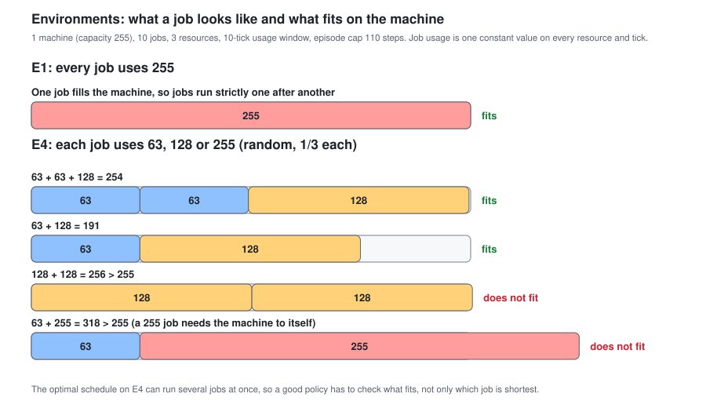

**How the models relate, with results on E4:**

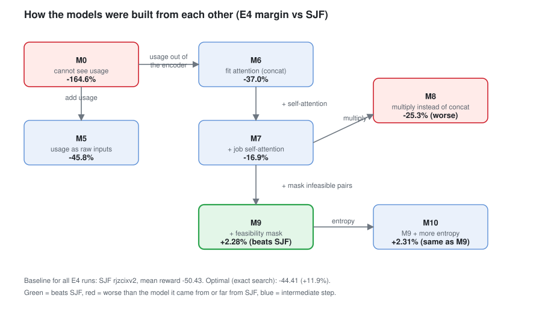

**E4 results vs SJF:**

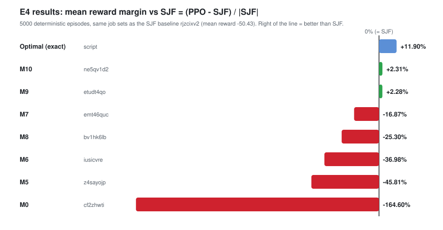

### Network diagrams

**M0**: baseline (`np7aenua`), cannot see usage.

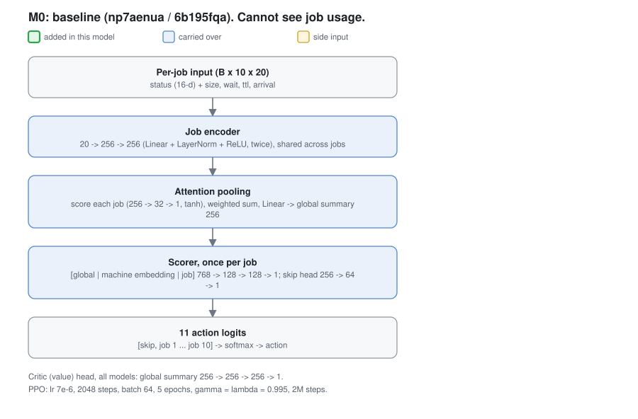

**M1**: M0 + `queue_pressure` + job self-attention (`g231w4jg`, best on E1).

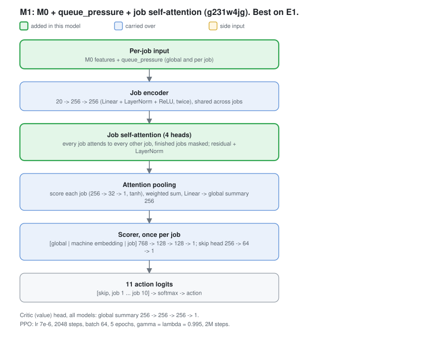

**M5**: usage as raw inputs (`z4sayojp`).

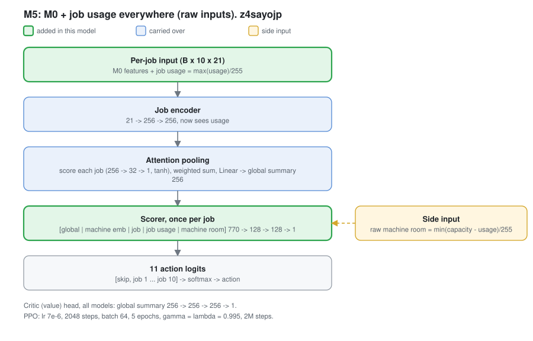

**M6**: fit attention, usage kept out of the encoder (`iusicvre`).

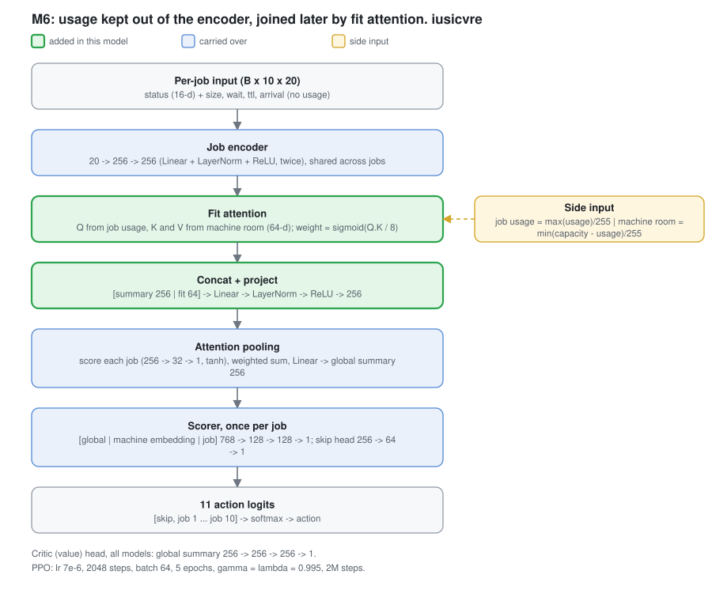

**M7**: M6 + job self-attention (`emt46quc`).

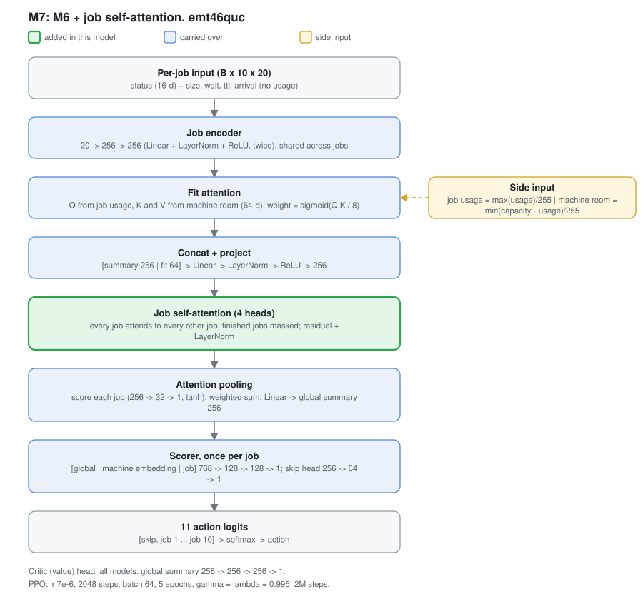

**M8**: multiplicative fusion (`bv1hk6lb`, not adopted).

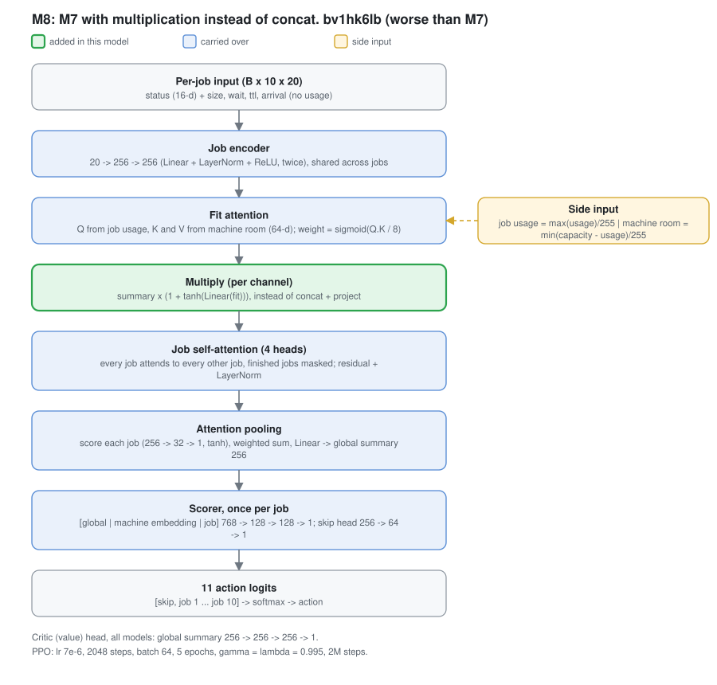

**M9**: M7 + feasibility mask (`etudt4qo`, current best on E4).

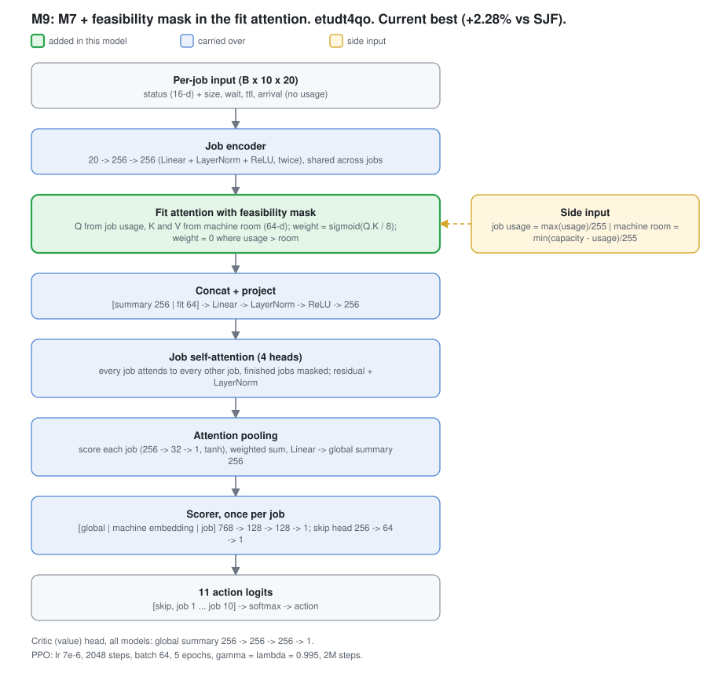

**M10**: M9 with a higher entropy coefficient (`ne5qv1d2`, no change).

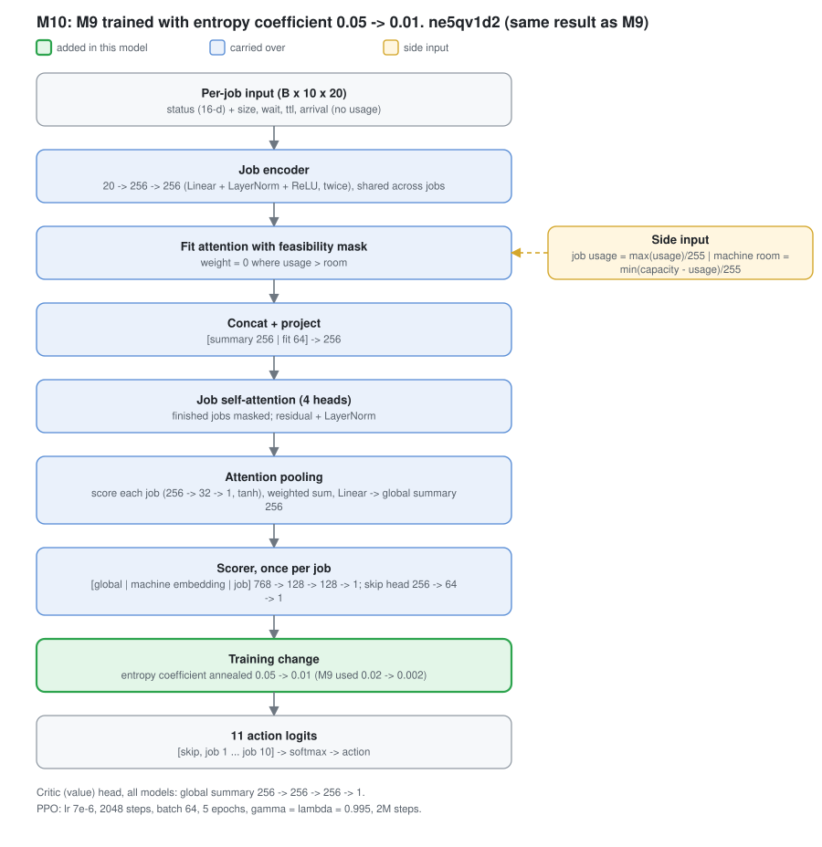

**M11**: M9 on E1 with a not-created mask: unarrived jobs are zeroed and masked out of self-attention and pooling (`j5ojvpto`).

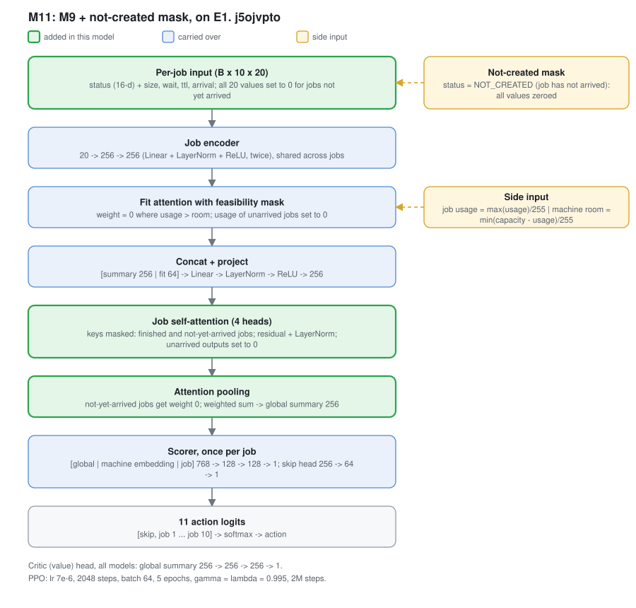

## Current best configuration

**Note:** the two results below are on two *different* tasks and are not comparable to each other. The exclusive-occupation result (`g231w4jg`) is the best result on the original task, before the generator changed to random per-job utilization (#16-20). The concurrent-packing task introduced in section 7 has no winning configuration yet — `gg3l5d00` (#20) is the current frontier there, still trailing SJF (mean margin -15.77%).

**Best on the original (exclusive-occupation) task:** Run `stellar-dawn-304` (`g231w4jg`): base features (`status`, `size`, `wait_time`, `ttl`, `arrival_time`) + `queue_pressure` (global and per-job) + job self-attention with `COMPLETED` masked out of attention keys + residual-sum job-context update + standard (non-terminating) failure handling + `gamma=0.995, gae_lambda=0.995`, 2M training steps.

**Result vs. SJF baseline** (5000 eval episodes, deterministic policy): 82.00% ties, PPO wins 14.14% (707), SJF wins 3.86% (193), mean reward margin **+1.14%**, wait-time margin -0.83%, completion-time margin -0.62%.

**Result vs. true optimal** (same 5000 episodes, exact DP solver): PPO matches the literal optimal schedule on 90.68% of episodes (vs. SJF's 80.96%) and closes ~70-73% of the reward/wait-time/completion-time gap between SJF and optimal. This is the strongest validation of the trained policy in this log — it's closing most of the way to a real mathematical ceiling, not just beating a heuristic that might itself be mediocre on this task.

**Current best on E4 (constant usage 63/128/255):** Run `etudt4qo` (M9, section 8 #29): fit attention with a feasibility mask + concat + masked job self-attention, `gamma=0.995`, 2M steps. Mean reward margin **+2.28%** vs SJF (`rjzcixv2`), exact optimal is +11.9%.

**Earlier frontier on the random-utilization packing task (section 7):** Run `gg3l5d00` (#20) — `usage` + `fit_slack` features, explicit per-pair fit-scoring term in `score_net`, narrowed `[40%,60%]` utilization curriculum, `gamma=0.995`, 2M steps. **Not yet beating SJF**: mean reward margin -15.77%, SJF win rate 70.86% vs. PPO's 13.20%, 15.94% ties. The learned fit-gate variant (#21) that followed was a clear regression from this (-89.98% margin) and is not adopted. See section 7 for the full progression.

## What the pattern across all of this says

Roughly half the experiments that sounded well-reasoned in isolation (`ttl` removal, wider arrival distribution, deeper networks, higher gamma) turned out to be regressions once actually measured — and the two changes that most reliably improved things (`arrival_time`, `queue_pressure` in the per-job path, masked self-attention) all share a common thread: they gave the model *more accurate information exactly where the decision gets made*, rather than more capacity or a differently-shaped task. The diagnosed root cause (waiting for marginally-better jobs without weighing queue depth) has been narrowed but not fully solved — SJF still wins ~4% of episodes, mostly via this same mechanism.
