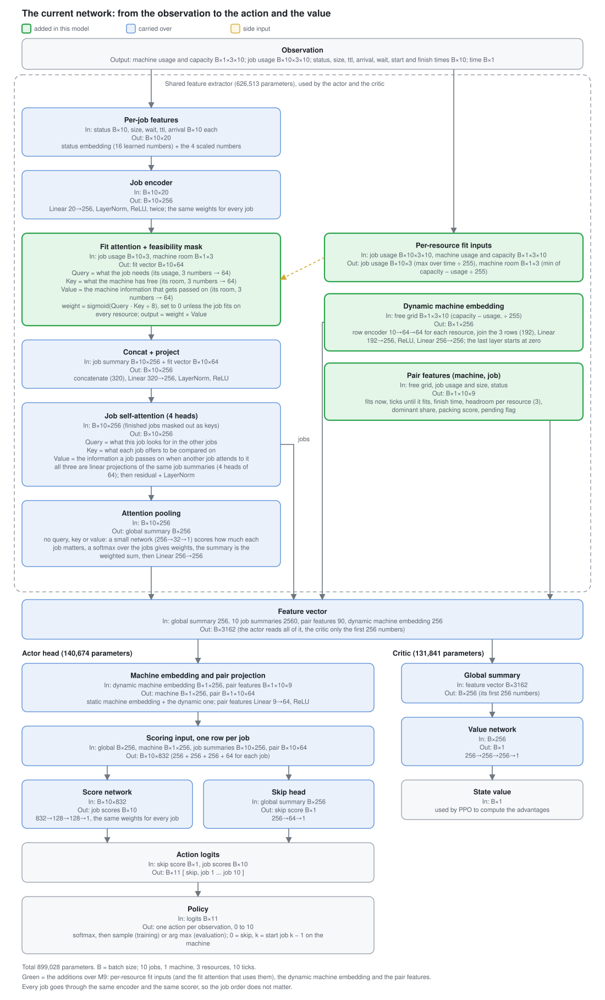
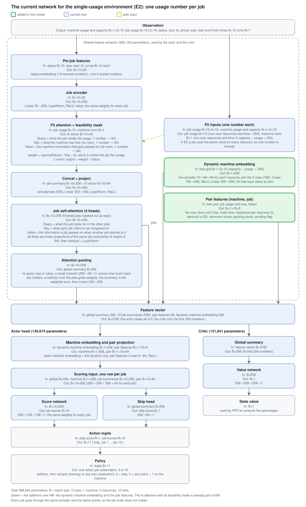
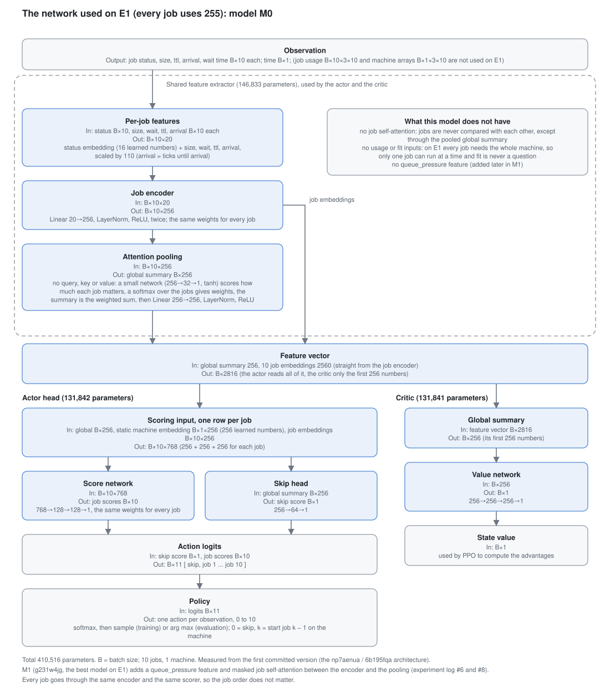
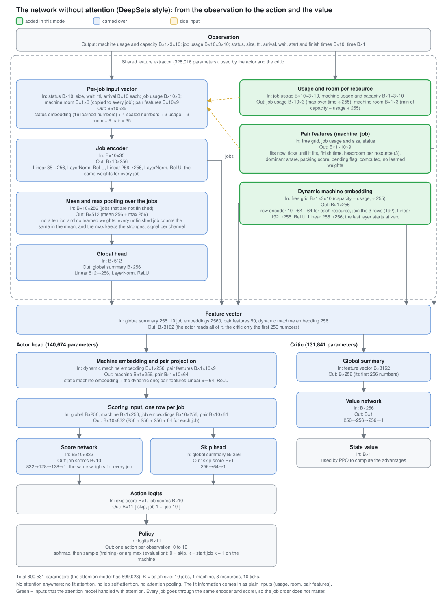

# The current network, stage by stage (input to action and value)

The network used by the PPO runs `pfrw14vh`, `vy9asra5` and the later seeds: model M9 plus per-resource fit inputs, pair features and a dynamic machine embedding. Shapes and parameter counts below were measured by building the policy and running a forward pass.

Notation: `B` = batch size, `n` = 10 jobs, `m` = 1 machine, `R` = 3 resources, `T` = 10 ticks, `E` = 256 (embedding size). Code references are in `src/scheduling_simulator/expiremnt/`: `NF` = [`feature_extractor/new_features.py`](../src/scheduling_simulator/expiremnt/feature_extractor/new_features.py), `NS` = [`policy/new_sched.py`](../src/scheduling_simulator/expiremnt/policy/new_sched.py).

## Table

| # | Stage | Code | Input | Operation | Output | Params | Why |
|---|---|---|---|---|---|---|---|
| 0 | Observation | environment | dict: `machines_usage`, `machines_capacity` `B×1×3×10`; `jobs_usage` `B×10×3×10`; `status`, `size`, `ttl`, `arrival`, `wait_time`, `scheduled_at`, `finished_at` `B×10`; `time` `B×1`; `action_success` | none, this is what the environment returns | same | 0 | the full state, including jobs that have not arrived yet |
| 1 | Scaling and derived inputs | NF:351 to :396 | the observation | size, wait ÷ 110; ttl capped to [0, 1] after ÷ 110; arrival = (arrival − time) ÷ 110 capped to [0, 1]; job usage = max over time ÷ 255; machine room = min over time of (capacity − usage) ÷ 255 | scalars `B×10`, job usage `B×10×3`, machine room `B×1×3` | 0 | same scale for every input; usage and room are one number per resource |
| 2 | Status embedding | NF:142, :413 | `status` `B×10` (4 values) | learned lookup table | `B×10×16` | 80 | a learned vector for each job state |
| 3 | Per-job feature vector | NF:423 | status embedding + size, wait, ttl, arrival | concatenate | `B×10×20` | 0 | usage is left out here on purpose |
| 4 | Job encoder | NF:156, :444 | `B×10×20` | Linear 20→256, LayerNorm, ReLU, Linear 256→256, LayerNorm, ReLU, same weights for every job | `B×10×256` | 72,192 | one description rule for all jobs, so job order does not matter |
| 5 | Fit query, key, value | NF:181 to :190, :471 | job usage `B×10×3`; machine room `B×1×3` | three small networks, each Linear 3→64, ReLU, Linear 64→64 | query `B×10×64`; key, value `B×1×64` each | 13,248 (4,416 × 3) | puts "what the job needs" and "what the machine has" in the same space |
| 6 | Fit score, sigmoid and mask | NF:475 to :488 | query, key, value | score = Q·K ÷ 8; weight = sigmoid(score); weight × can_fit, where can_fit is "job usage ≤ machine room on every resource"; output = weight × V | fit vector `B×10×64` | 0 | an explicit, exact "does it fit" signal; a sigmoid, not a softmax, so one machine still gives a per-job answer |
| 7 | Concat and project | NF:193, :490 | job summary `B×10×256` + fit vector `B×10×64` | concatenate to 320, Linear 320→256, LayerNorm, ReLU | `B×10×256` | 82,688 | mixes the fit information into each job's summary |
| 8 | Job self-attention | NF:206 to :212, :501 to :512 | `B×10×256`, finished jobs masked as keys | 4-head self-attention (Q, K, V all from the jobs), then residual and LayerNorm | `B×10×256` | 263,168 + 512 | each job sees how it compares with the other jobs (SJF's rule is relative) |
| 9 | Attention pooling | NF:218, :235, :518 to :535 | `B×10×256` | score each job (Linear 256→32, tanh, Linear 32→1), softmax over the jobs, weighted sum, then Linear 256→256, LayerNorm, ReLU | global summary `B×256` | 8,257 + 66,304 | one fixed-size description of the whole queue, focused on the jobs that matter |
| 10 | Dynamic machine embedding | NF:252 to :264, :565 to :575 | free grid = (capacity − usage) ÷ 255, `B×1×3×10` | row encoder 10→64→64 (shared over the 3 resources), join rows (192), Linear 192→256, ReLU, Linear 256→256 (last layer starts at zero) | `B×1×256` | 4,864 + 115,200 | the scorer sees what the machine is running now and next; the zero start means training begins like M9 |
| 11 | Pair features | NF:266 to :338, :559 | free grid, job usage and size, status | for each (machine, job): pending flag, fits now, ticks until it fits (tested at every start 0 to 9), finish time, headroom per resource (3), largest resource share, packing score | `B×1×10×9` | 0 | exact timing and packing numbers, computed instead of learned |
| 12 | Feature vector | NF:551 to :575 | pieces from stages 8 to 11 | concatenate [global 256 | 10 job summaries 2560 | pair features 90 | dynamic machine 256] | `B×3162` | 0 | the single vector handed to the actor; the critic uses only its first 256 numbers |
| 13 | Machine embedding and pair projection | NS:137, :146, :273, :340 | feature vector parts | static machine embedding (`1×256`) plus the dynamic one; Linear 9→64 and ReLU on the pair features | machine `B×1×256`; pair `B×1×10×64` | 256 + 640 | the machine is described both by identity and by current state |
| 14 | Per-job scoring input | NS:342 to :360 | global, machine, job summary, pair projection | for each of the 10 jobs concatenate 256 + 256 + 256 + 64 | `B×10×832` | 0 | each job is scored with the queue, the machine and its own fit |
| 15 | Score network | NS:163, :361 | `B×10×832` | Linear 832→128, ReLU, Linear 128→128, ReLU, Linear 128→1, same weights for every job | job scores `B×10` | 123,265 | one scoring rule for all jobs |
| 16 | Skip head | NS:186, :369 | global summary `B×256` | Linear 256→64, ReLU, Linear 64→1 | skip score `B×1` | 16,513 | lets the model decide to wait without competing with a specific job |
| 17 | Action logits | NS:377 | skip score, 10 job scores | concatenate `[skip, job 1 … job 10]` | logits `B×11` | 0 | action 0 = skip, action k = start job k − 1 on machine 0 |
| 18 | Policy | SB3 `ActorCriticPolicy` (NS:425) | logits | softmax, sample (training) or arg max (evaluation) | action in 0 to 10 | 0 | a categorical policy |
| 19 | Critic | NS:386, :536; `SchedulingMlpExtractor.forward_critic` (NS:67) | first 256 numbers of the feature vector (the global summary) | Linear 256→256, ReLU, Linear 256→256, ReLU, Linear 256→1 | value `B×1` | 131,841 | a state-value estimate for PPO's advantages |

## Parameter totals

| Part | Parameters |
|---|---|
| Feature extractor (stages 2 to 12) | 626,513 |
| Action head (stages 13 to 16) | 140,674 |
| Value network (stage 19) | 131,841 |
| **Total** | **899,028** |

## Notes

- **The actor and the critic share the same feature extractor.** I checked this in the instantiated policy (`pi_features_extractor is features_extractor` is true). The critic's loss therefore also trains the extractor, and it sees only the global summary, not the pair features or the dynamic machine embedding. An earlier message of mine suggested they had separate copies; that was wrong.
- **Where the order of jobs is ignored.** Stages 2 to 9 and 14 to 15 treat each job the same way and have no position input.
- **Fit mask versus pair features.** Both say "does the job fit". The mask inside the fit attention uses the usage and room scalars; the pair features also test future start offsets against the whole free grid.

## Diagram

The same stages as the table, drawn from the observation to the action and the value. Green boxes are the additions over M9 (per-resource fit inputs, dynamic machine embedding, pair features); the dashed frame is the feature extractor shared by the actor and the critic.

Regenerate with `.venv/bin/python scripts/docs_tools/make_diagrams.py` to rebuild the SVG. A PNG copy can be made with `rsvg-convert -w 1500 docs/diagrams/network_full.svg -o docs/diagrams/network_full.png`.

## Variant for the single-usage environment (E2)

In E2 every job uses the same value on every resource, so the fit attention can take one usage number per job and one room number per machine instead of three (`per_resource_fit=False`). Everything else is the same. The fit networks shrink by 128 parameters each, which gives 898,644 parameters in total (feature extractor 626,129; action head 140,674; value network 131,841). The pair features and the dynamic machine embedding are optional in the code; this diagram keeps them on. M9 is the same network without those two.

## Variant for E1 (every job uses 255): model M0

On E1 the model that ran was M0 (run `6b195fqa`, and the original `np7aenua`). It has no usage or fit inputs, no job self-attention and no pair features or dynamic machine embedding, because on E1 only one job runs at a time and fit is never a question. Shapes and parameter counts (410,516 in total: feature extractor 146,833; action head 131,842; value network 131,841) were measured from the first committed version of the code, commit `76f8435`. M1 (`g231w4jg`) adds a queue_pressure feature and masked job self-attention; its exact layer sizes are not in the current code, so it is not drawn.

## Variant without attention (DeepSets style)

The model `NoAttentionSchedulingPolicy` (runs `v3wyp6zb` and `nj5red65` on the 3-resource environment) has no fit attention, no job self-attention and no attention pooling. The per-job encoder receives the usage, the machine room and the pair features as plain inputs (35 numbers per job), and the jobs are summarised by mean and max pooling over the unfinished jobs. The actor head and critic are the same as above. It has 600,531 parameters (feature extractor 328,016; action head 140,674; value network 131,841).

